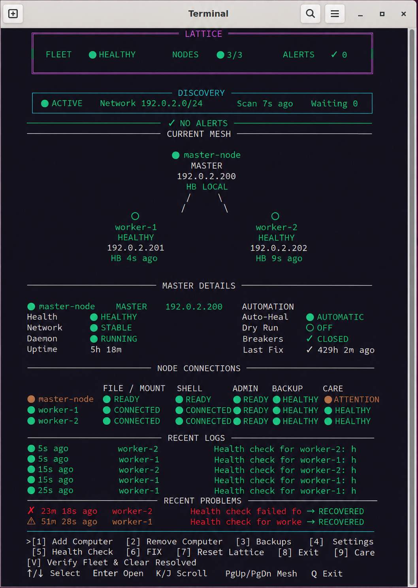

# Lattice

**Manage a small fleet of Linux computers from one machine.**

Lattice connects Ubuntu and Linux Mint computers on a trusted LAN using one **Master** and one or more **Workers**. From the Master, you can monitor fleet health, access peer files, use trusted shell connections, manage backups and restores, and run conservative maintenance without bringing in enterprise fleet-management infrastructure.

> **Current status:** Alpha / early public release. Lattice is already running on real multi-machine fleets, but it should still be treated as software for technically comfortable users who can review changes, backups, and recovery behavior before relying on it for important data.



## What Lattice does

- **Fleet health** — monitor paired computers and their last-known state from one Master
- **Persistent peer file access** — mount another Lattice computer's exported Home through a dedicated transport
- **Trusted shell connectivity** — maintain authenticated shell access between active fleet members
- **Bounded auto-heal** — recover a deliberately limited set of known failures instead of running unrestricted repair logic
- **Backups and restores** — source-owned Restic backups, staged restore workflows, and encrypted recovery-kit support
- **Daily Care** — conservative maintenance and health checks with explicit safety boundaries
- **Network reconciliation** — detect and reconcile supported NetworkManager state changes
- **Operator TUI + CLI** — everyday fleet management from the terminal through a read-only operator interface and narrow privileged controls

## Architecture

```text
                    ┌─────────────────────┐
                    │    Lattice Master   │
                    │  status / control   │
                    └─────────┬───────────┘
                              │
                signed fleet state + LAN
                              │
              ┌───────────────┴───────────────┐
              │                               │
      ┌───────▼────────┐              ┌───────▼────────┐
      │ Lattice Worker │              │ Lattice Worker │
      │ files / shell  │              │ files / shell  │
      │ health / care  │              │ health / care  │
      └────────────────┘              └────────────────┘
```

Lattice separates normal fleet management from privileged host operations and uses dedicated transports for file access, trusted shell access, backups, pairing, and recovery.

## Good fit for

Lattice is intended for people who run a **small trusted Linux fleet** such as:

- a homelab
- several household Linux computers
- a workshop or small office
- a personal development/test fleet
- a few headless and desktop machines on the same trusted LAN

It is **not** intended to replace enterprise MDM, Kubernetes, Active Directory, or large-scale configuration-management systems.

## Supported systems

Lattice v0.1 supports:

- Ubuntu
- Linux Mint
- NetworkManager-based networking
- Python 3.10–3.12

Other distributions and network stacks are not currently qualified.

## Quick start

Lattice installation requires a real Git checkout. GitHub's **Download ZIP** is not supported because the installer verifies tracked release files and Git metadata.

```bash
git clone https://github.com/dundunna1990/lattice-public.git
cd lattice-public
sudo ./lattice-bootstrap.sh
```

The bootstrap installs Lattice and immediately opens the guided setup wizard.

Choose one computer as the **Master** and each additional computer as a **Worker**. Pair Workers from the Master using the one-time pairing flow.

After setup:

```bash
lattice re-run
```

Useful read-only checks:

```bash
lattice status
lattice workers list
lattice shell status
lattice system status
```

## Safety model

Lattice deliberately favors **safe-stop and bounded repair** over aggressive automation.

Examples:

- Daily Care refuses maintenance when its safety checks cannot prove the action is within policy.
- Worker privilege elevation is limited to narrow root-owned helpers.
- Restore operations use staged placement and explicit conflict handling.
- Fleet membership state is signed.
- Dedicated SSH transports use strict host-key verification.
- Real-machine destructive tests are opt-in rather than part of normal test runs.

Peer Home mounts are **intentionally read/write**. Writing through a peer mount changes that peer's real Home directory.

## Documentation

Start here:

- [Documentation index](docs/README.md)
- [Installation](docs/INSTALLATION.md)
- [Operator guide](docs/OPERATOR_GUIDE.md)
- [Architecture](docs/ARCHITECTURE.md)
- [Configuration](docs/CONFIGURATION.md)
- [Backup and recovery](docs/BACKUP_AND_RECOVERY.md)
- [Daily Care](docs/DAILY_CARE.md)
- [Security](docs/SECURITY.md)
- [Troubleshooting](docs/TROUBLESHOOTING.md)

## Testing

The repository includes unit, integration, and opt-in real-machine E2E tests.

Normal CI currently runs against Python 3.10, 3.11, and 3.12. Real-machine destructive tests require explicit environment configuration and safety gates; they are intentionally excluded from ordinary CI.

## Project stage

Lattice is currently **v0.1.0 / Alpha**.

The focus is on:

- correctness and recovery safety
- dependable behavior on small real fleets
- clear operator visibility
- conservative automation
- improving clean-install and real-machine qualification

Bug reports and technically detailed feedback are welcome.

## Contributing

Lattice is open source under the **Apache License 2.0**.

If you want to contribute, start by opening an issue describing the problem, proposed change, or test case. For code changes, keep fixes focused and include regression coverage when practical.

See [CONTRIBUTING.md](CONTRIBUTING.md).

## License

Copyright 2026 Lattice contributors.

Licensed under the [Apache License 2.0](LICENSE).
